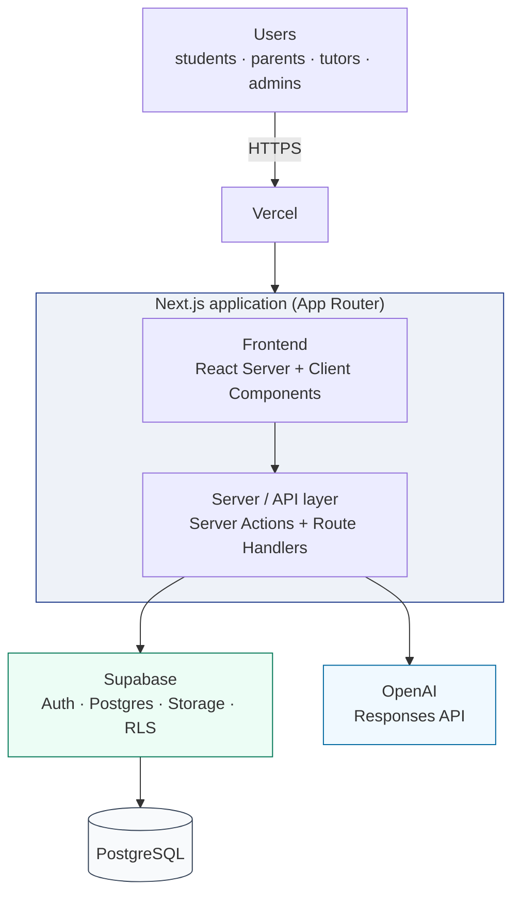
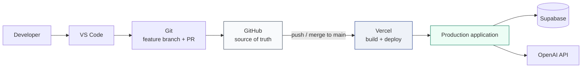
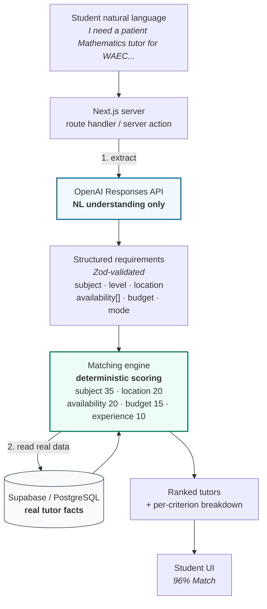
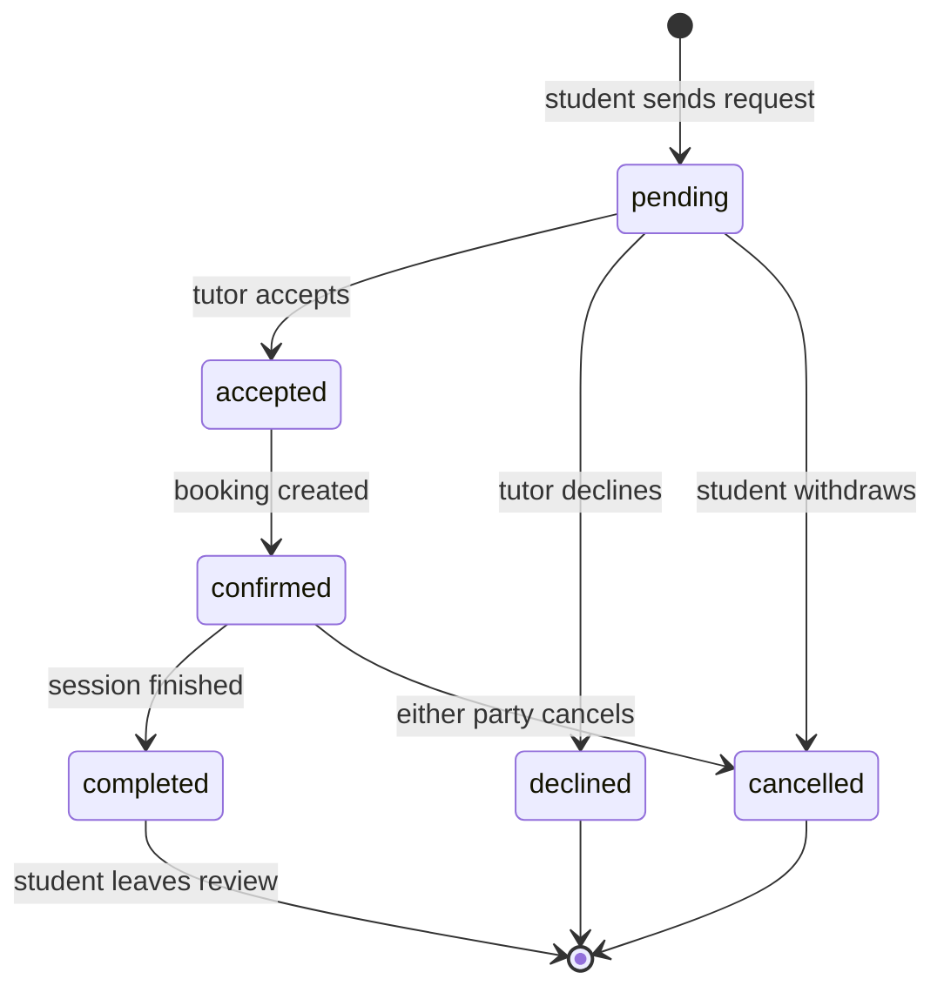
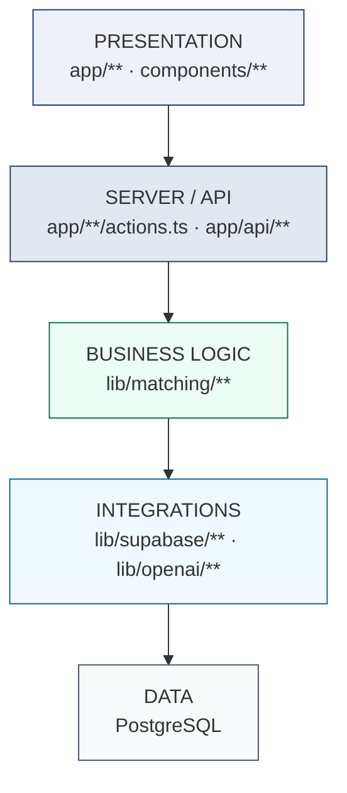

# TutorMatch IB — System Diagrams

Diagram sources for the architecture slides. Each section gives a plain-text
flow and the Mermaid source, so a diagram can be pasted into any tool.

---

## 1. High-level system architecture

```
                        ┌─────────────────────┐
                        │       Users        │
                        │  students, parents, │
                        │   tutors, admins    │
                        └──────────┬──────────┘
                                   │  HTTPS
                                   ▼
                        ┌─────────────────────┐
                        │       Vercel       │
                        └──────────┬──────────┘
                                   │
                                   ▼
             ┌───────────────────────────────────────────┐
             │        Next.js application (App Router)   │
             │                                           │
             │   ┌─────────────────────────────────────┐ │
             │   │  Frontend (React Server + Client)  │ │
             │   └────────────────┬────────────────────┘ │
             │                    │                      │
             │                    ▼                      │
             │   ┌─────────────────────────────────────┐ │
             │   │  Server / API layer                 │ │
             │   │  Server Actions + Route Handlers    │ │
             │   └──────┬───────────────────────┬──────┘ │
             └──────────┼───────────────────────┼────────┘
                        │                       │
                        ▼                       ▼
          ┌──────────────────────┐   ┌────────────────────────┐
          │      Supabase       │   │        OpenAI          │
          │  Auth + Postgres    │   │   Responses API        │
          │  Storage + RLS      │   │  (requirement extract) │
          └──────────┬───────────┘   └────────────────────────┘
                     │
                     ▼
          ┌──────────────────────┐
          │      PostgreSQL      │
          │  profiles, tutors,   │
          │  availability,       │
          │  requests, bookings, │
          │  reviews             │
          └──────────────────────┘
```



---

## 2. Deployment flow

```
Developer
   │
   ▼
VS Code
   │
   ▼
Git  ──►  GitHub  ──►  Vercel  ──►  Production application
                                              │
                                              ├──► Supabase (Postgres, Auth, Storage)
                                              └──► OpenAI API
```



**Secret handling:** environment variables are set in Vercel project settings.
No secret is ever committed. `.env*` is git-ignored; only `.env.example`, with
empty values, is tracked.

---

## 3. AI matching flow

This is the flow that judges will ask about, because it shows where the AI stops
and deterministic logic begins.

```
Student natural language
        │
        │  "I need a patient Mathematics tutor for WAEC preparation.
        │   My daughter is available Tuesday and Thursday evenings
        │   and we prefer someone around Bodija. Our budget is
        │   around ₦7,000 per lesson."
        ▼
Next.js server  (route handler / server action)
        │
        ├──► OpenAI Responses API        ← natural language understanding ONLY
        │            │
        │            ▼
        │     Structured requirements     (Zod-validated)
        │     { subject, level, location,
        │       availability[], budget,
        │       teachingMode }
        │
        ▼
Matching engine  ← deterministic scoring, no LLM
        │
        ├──► Supabase / PostgreSQL       ← real tutor facts
        │       subjects, location, availability,
        │       hourly rate, experience
        ▼
Ranked tutors  +  per-criterion breakdown
        │
        ▼
Student UI  "96% Match · subject 35/35 · within budget · 2 slots free"
```



### The boundary, stated plainly

| OpenAI **may** do                                    | OpenAI **may not** do                                 |
| ---------------------------------------------------- | ------------------------------------------------------ |
| Read the student's sentence                          | State or imply a tutor's rate                        |
| Extract subject, level, location, slots, budget      | State a tutor's availability or rating               |
| Normalise free text ("Tue nights" → tuesday/evening) | Confirm a tutor exists or is free                     |
| Optionally rewrite the requirement in plain language  | Produce a match score or percentage                   |
| Return strictly to a schema                          | Act as a source of truth for any database fact        |

If OpenAI is unavailable, the filter form plus the same matching engine still
produces results. **AI is an accelerator, not a dependency.**

---

## 4. Request to booking lifecycle

```
        Student/Parent                        Tutor
              │                                │
              │  1. submit tutor request       │
              ├───────────────────────────────►│
              │                                │
              │                  2. accept     │
              │◄───────────────────────────────┤
              │                                │
              │  3. booking confirmed          │
              │◄───────────────────────────────┤
              │                                │
              │  4. review after session       │
              ├───────────────────────────────►│
              │                                │
              ▼                                ▼
```

| Step | Actor       | Action                | Resulting state                    |
| ---- | ----------- | --------------------- | ---------------------------------- |
| 1    | Student     | Send tutor request    | `tutor_requests.status = pending`  |
| 2    | Tutor       | Accept or decline     | `accepted` or `declined`           |
| 3    | System      | Confirm session time  | `bookings.status = confirmed`      |
| 4    | Student     | Review completed work| `reviews` row created               |



---

## 5. Layered code structure

```
┌─────────────────────────────────────────────────┐
│  PRESENTATION    app/**  components/**          │
│  pages · layout · tutor cards · forms           │
└───────────────────────┬─────────────────────────┘
                        │ server actions / route handlers
                        ▼
┌─────────────────────────────────────────────────┐
│  SERVER / API     app/**/actions.ts  app/api/** │
│  parse input · authorize · orchestrate          │
└───────────────────────┬─────────────────────────┘
                        ▼
┌─────────────────────────────────────────────────┐
│  BUSINESS LOGIC   lib/matching/**               │
│  deterministic scoring · pure functions         │
└───────────────────────┬─────────────────────────┘
                        ▼
┌─────────────────────────────────────────────────┐
│  INTEGRATIONS     lib/supabase/**  lib/openai/** │
│  postgres + RLS       Responses API             │
└───────────────────────┬─────────────────────────┘
                        ▼
┌─────────────────────────────────────────────────┐
│  DATA             PostgreSQL                    │
└─────────────────────────────────────────────────┘
```

Dependencies point downward only. A component never reaches past the server
layer into the database or into OpenAI.



---

## 6. Security boundaries

```
┌──────────────────────────────────────────┐
│              BROWSER                     │
│  NEXT_PUBLIC_* only                      │
│  anon Supabase key (RLS protects data)   │
└───────────────────┬──────────────────────┘
                    │  ▲
   secrets blocked  │  │  cookies only
                    ▼  │
┌──────────────────────────────────────────┐
│           NEXT.JS SERVER                 │
│  OPENAI_API_KEY          SERVER ONLY     │
│  SUPABASE_SERVICE_ROLE   SERVER ONLY     │
│  authorization + Zod validation          │
└────────┬──────────────────────────┬──────┘
         │                          │
         ▼                          ▼
┌────────────────────┐   ┌──────────────────────┐
│  SUPABASE          │   │  OPENAI              │
│  + RLS policies    │   │  server-side only    │
└────────────────────┘   └──────────────────────┘
```

| Secret                                  | Reachable from browser? |
| --------------------------------------- | ----------------------- |
| `OPENAI_API_KEY`                        | **No**                  |
| `SUPABASE_SERVICE_ROLE_KEY`             | **No**                  |
| `NEXT_PUBLIC_SUPABASE_URL`              | Yes                     |
| `NEXT_PUBLIC_SUPABASE_PUBLISHABLE_KEY`    | Yes                     |

Any value without the `NEXT_PUBLIC_` prefix stays on the server. Environment
reads go through `lib/env.ts`, which validates values with Zod and makes the
server-only intent explicit.
